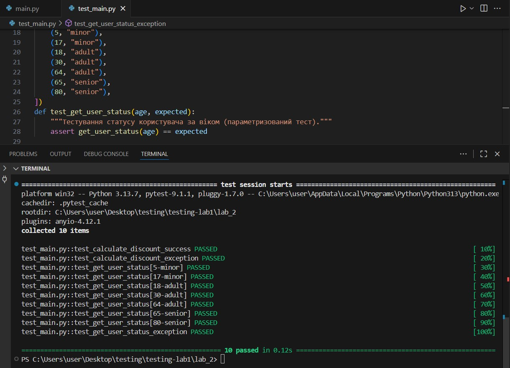

# Звіт до лабораторної роботи №2 з тестування ПЗ
**Тема:** Модульне тестування за допомогою фреймворку `pytest`  
**Виконала:** Гащук Юлія Володимирівна  
**Група:** КН-41  

---

## 1. Мета роботи
Ознайомитися з можливостями сучасного фреймворку тестування `pytest` у мові програмування Python. Навчитися писати модульні тести без обов'язкового створення класів, застосовувати механізм параметризації (`@pytest.mark.parametrize`) та перевіряти коректність викидання винятків за допомогою конструкції `pytest.raises`.

---

## 2. Структура проекту
* `lab_2/main.py` — модуль з основною бізнес-логікою (функції розрахунку знижок та визначення вікових категорій користувачів).
* `lab_2/test_main.py` — набір тестів із використанням фреймворку `pytest`.
* `lab_2/screenshot.jpg` — скріншот успішного виконання набору тестів у терміналі.
* `lab_2/README.md` — звіт про виконання лабораторної роботи.

---

## 3. Хід роботи
1. У головному репозиторії проєкту створено окрему робочу директорію `lab_2`.
2. У файлі `main.py` реалізовано алгоритми перевірки вхідних даних та обчислень (`calculate_discount`, `get_user_status`), які генерують винятки `ValueError` у разі некоректних параметрів.
3. У файлі `test_main.py` написано тестові функції для перевірки успішних сценаріїв та обробки помилок. Для оптимізації коду перевірки різних вікових діапазонів використано декоратор параметризації `@pytest.mark.parametrize`.
4. Запущено середовище тестування через термінал за допомогою команди `py -m pytest -v`.

---

## 4. Результати виконання тестів

Виконання команди `py -m pytest -v`:

test_main.py::test_calculate_discount_success PASSED                                                                    [ 10%] 
test_main.py::test_calculate_discount_exception PASSED                                                                  [ 20%] 
test_main.py::test_get_user_status[5-minor] PASSED                                                                      [ 30%] 
test_main.py::test_get_user_status[17-minor] PASSED                                                                     [ 40%] 
test_main.py::test_get_user_status[18-adult] PASSED                                                                     [ 50%] 
test_main.py::test_get_user_status[30-adult] PASSED                                                                     [ 60%] 
test_main.py::test_get_user_status[64-adult] PASSED                                                                     [ 70%] 
test_main.py::test_get_user_status[65-senior] PASSED                                                                    [ 80%] 
test_main.py::test_get_user_status[80-senior] PASSED                                                                    [ 90%] 
test_main.py::test_get_user_status_exception PASSED                                                                     [100%] 

===================================================== 10 passed in 0.12s ===================================================== 

---

## 5. Висновки

* **Що зроблено в роботі:** Було успішно розроблено модуль з бізнес-логікою у файлі `main.py` та набір модульних тестів за допомогою сучасного фреймворку `pytest` у файлі `test_main.py`. Оформлено звіт та завантажено всі матеріали до віддаленого репозиторію на GitHub.
* **Чи досягнуто мети роботи:** Так, мету роботи повністю досягнуто — опановано базові та розширені можливості фреймворку `pytest` (зокрема параметризацію та тестування винятків).
* **Які нові знання отримано:** Отримано практичний досвід використання інструменту `pytest`, який дозволяє писати більш лаконічні тести без створення спеціальних тестових класів, а також навчилися ефективно перевіряти вхідні дані за допомогою декоратора `@pytest.mark.parametrize` та конструкції `pytest.raises`.
* **Чи вдалось відповісти на всі питання задані в ході роботи:** Так, усі ключові питання щодо синтаксису, обробки винятків та запуску тестів у середовищі `pytest` були повністю розкриті й перевірені на практиці.
* **Чи вдалося виконати всі завдання:** Так, усі заплановані етапи лабораторної роботи виконано в повному обсязі та без помилок.
* **Чи виникли складності у виконанні завдання:** Ні, під час виконання завдання жодних складностей не виникло.
* **Чи подобається такий формат здачі роботи (Feedback):** Формат здачі робіт є дуже зручним, наочним та наближеним до реальних умов командної розробки.
* **Побажання для покращення (Suggestions):** Зауважень немає, матеріали та структура подачі матеріалу є зрозумілими та доступними.