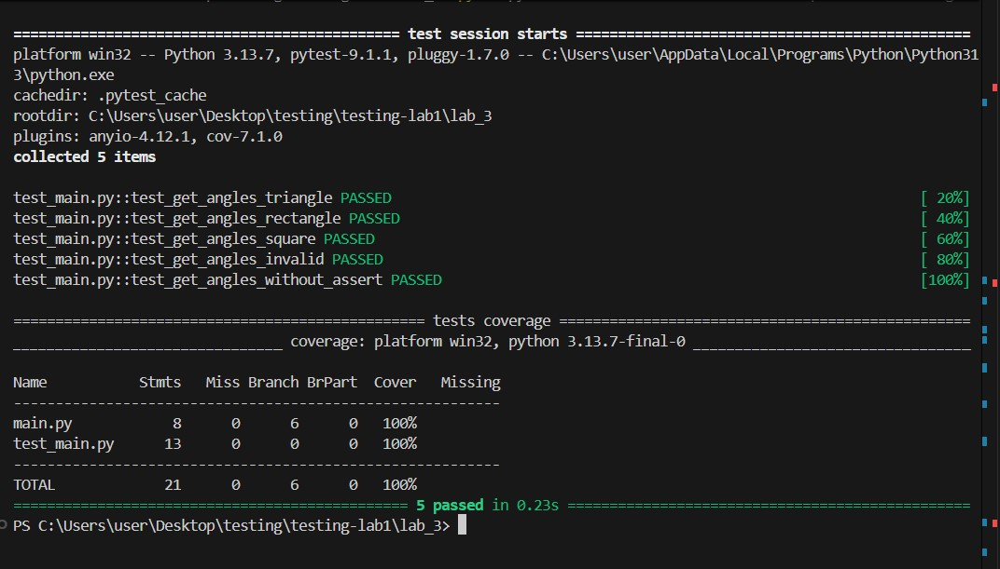

# Звіт до лабораторної роботи №3 з тестування ПЗ

**Тема:** Дослідження покриття коду тестами (Code Coverage) за допомогою `pytest-cov`  
**Виконала:** Гащук Юлія Володимирівна  
**Група:** КН-41  

---

## Мета роботи
Ознайомитися з поняттям покриття коду тестами (Code Coverage), навчитися використовувати інструмент `pytest-cov` для аналізу того, яка частина програмного коду виконується під час тестування, та виявляти не охоплені тестами ділянки.

---

## Виконання роботи

### Результати виконання завдання:
* Розробили модуль бізнес-логіки `main.py` із функціями перевірки числа на парність та обчислення загальної вартості замовлення.
* Створили набір модульних тестів у файлі `test_main.py` для перевірки як успішних сценаріїв, так і винятків.
* Програма вивела значення стовідсоткового покриття коду під час запуску утиліти `pytest-cov`.
* Отримано наступні результати: всі створені тести успішно пройшли перевірку, а звіт зафіксував 100% покриття рядків коду.
* Навчились аналізувати звіт `Coverage` та використовувати параметри перевірки нетестованих гілок.

### Скріншот виконання завдання:

### Відповіді на контрольні запитання та пояснення
 * Порівняння покриття рядків і розгалужень (Line vs Branch Coverage):
 Line coverage показує, чи виконувався конкретний рядок коду хоча б один раз.
 Branch coverage перевіряє, чи пройшли тести кожен можливий напрямок умовного переходу (if, elif, else). Наприклад, якщо протестувати лише трикутник і квадрат, гілка rectangle залишиться непокритою на рівні гілок, хоча загальні рядки можуть виконуватися.
 * Чому використано pragma: no cover:
 Цю директиву було застосовано до блоку запуску скрипта if __name__ == "__main__": main(). Оскільки цей блок призначений для ручного запуск через інтерпретатор, а не для автоматизованого тестування, його виключення дозволяє не спотворювати реальні показники покриття бізнес-логіки.
 * Призначення форматів звітів:
 HTML-звіт (htmlcov/index.html): Призначений для розробників. Він дозволяє зручно у браузері візуально переглядати код із підсвічуванням покритих і пропущених рядків.
 XML-звіт (coverage.xml): Призначений для автоматизованих систем (CI/CD, GitHub Actions) та сервісів аналізу якості коду.

 ### Висновки:
 * Що зроблено в роботі: Опановано інструменти вимірювання покриття коду та розгалужень за допомогою pytest-cov, створено тести для різних гілок виконання програми, налаштовано виключення за допомогою pragma: no cover та згенеровано HTML/XML звіти.
 * Чи досягнуто мети роботи: Так, мету повністю досягнуто.
 * Які нові знання отримано: Отримано практичний досвід аналізу метрик Line Coverage та Branch Coverage, виявлення нетестованих гілок умов та роботи звітів покриття.
 * Чи вдалось відповісти на всі питання задані в ході роботи: Так, усі питання щодо різниці між типами покриття, роботи з прагмами та форматами звітів опрацьовані.
 * Чи вдалося виконати всі завдання: Так, усі завдання виконано в повному обсязі.
 8 Чи виникли складності у виконанні завдання: Ні, під час виконання завдання жодних складностей не виникло.
 * Чи подобається такий формат здачі роботи (Feedback): Формат через GitHub та детальні звіти у форматі Markdown є зручним і практичним.
 * Побажання для покращення (Suggestions): Зауважень немає.